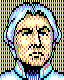

## 基本資料

| 項目 | 內容 |
| :--- | :--- |
| 中文譯名 | （待考證） |
| 原文 | （待考證） |
| 遊戲作品中名稱 | オイゲン / Eugen / 尤根 |
| 國籍 | 奧地利 |

## 遊戲數值

| ID | 政治 | 財政 | 補給 | 建設 | 指揮 | 步兵 | 騎兵 | 砲兵 | 冷靜 | 勇敢 | 魅力 | 幸運 |
| :---: | :---: | :---: | :---: | :---: | :---: | :---: | :---: | :---: | :---: | :---: | :---: | :---: |
| 156 | C | C | D | D | C | C | C | C |  |  |  |  |

## 人物畫像

<figure>

<figcaption>遊戲中的頭像</figcaption>
</figure>

## 列傳

（待考證）

遊戲中屬奧地利陣營，駐布拉格，任軍團長；1796 年劇本時 38 歲，推算約生於 1757–1758 年。日文名オイゲン即 Eugen。先前推定為萊納大公（Archduke Rainer，1783 年生），生年相差二十多年，已撤回。

## References

（無）
