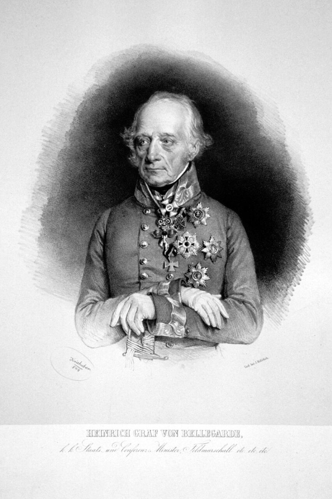

## 基本資料

| 項目 | 內容 |
| :--- | :--- |
| 中文譯名 | 海因里希·馮·貝勒加爾德 |
| 原文 | Heinrich von Bellegarde |
| 遊戲作品中名稱 | ベレガルデ / Belegarde / 貝利加德 |
| 國籍 | 奧地利 |

## 遊戲數值

| ID | 政治 | 財政 | 補給 | 建設 | 指揮 | 步兵 | 騎兵 | 砲兵 | 冷靜 | 勇敢 | 魅力 | 幸運 |
| :---: | :---: | :---: | :---: | :---: | :---: | :---: | :---: | :---: | :---: | :---: | :---: | :---: |
| 155 | D | D | C | C | C | C | C | B |  |  |  |  |

## 人物畫像

<figure>

<figcaption>海因里希·馮·貝勒加德的肖像</figcaption>
</figure>
<figure>

<figcaption>遊戲中的頭像</figcaption>
</figure>

## 列傳

海因里希·馮·貝勒加爾德（Heinrich von Bellegarde，1756-1845）是奧地利帝國元帥，也是[法蘭一世](/人物/拿破崙時代/法蘭一世)最倚重的義大利戰區專家。

貝勒加爾德在拿破崙戰爭期間長期在義大利與奧地利邊境作戰。1813–1814 年他統率義大利方面的奧軍，與[尤金](/人物/拿破崙時代/尤金)（歐仁·德·博阿爾內）對陣；戰後出任倫巴第–威尼西亞總督，後來擔任宮廷軍事會議（Hofkriegsrat）主席。

遊戲中的他屬奧地利陣營，1796 年劇本時 40 歲，與 1756 年出生相符。中文版把 ID 175（ベルク／Berg，巴伐利亞陣營）也譯成「貝利加德」，兩者並非同一人，見[貝利加德 (巴伐利亞)](/人物/拿破崙時代/貝利加德_巴伐利亞)。

## References

- [Heinrich von Bellegarde - Wikipedia](https://en.wikipedia.org/wiki/Heinrich_von_Bellegarde)
