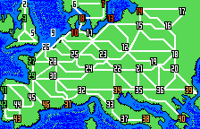
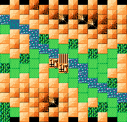

## 遊戲數值

| ID | 日文名 | 英文名 | 中文名 | 人口 | 農業 | 武器 | 港 |
| :--- | :--- | :--- | :--- | :--- | :--- | :--- | :--- |
| 44 | サラゴサ | Saragossa | 薩拉戈薩 | | | | |

## 地圖

<!-- data:map-world begin -->
<figure class="kw-map">

<figcaption>大地圖（FC 版）</figcaption>
</figure>
<!-- data:map-world end -->

<!-- data:map-battle begin -->
<figure class="kw-map">

<figcaption>戰場地圖（FC 版）</figcaption>
</figure>
<!-- data:map-battle end -->

## 簡介

薩拉戈薩（Saragossa）是[西班牙](/用語/西班牙)阿拉貢地區的首府，在拿破崙時代因其在[半島戰爭](/用語/半島戰爭.md)中兩次慘烈的圍城戰而名震全歐。1808 年與 1809 年，由帕拉福克斯指揮的西班牙市民與守軍，在簡陋的防禦設施下，與法軍展開了逐屋逐巷的血戰。

薩拉戈薩圍城戰表現出了極端驚人的抵抗意志，甚至婦女（如著名的瑪麗亞·奧古斯丁）也參與了第一線戰鬥。法軍最終在付出巨大傷亡後才佔領了這座已成廢墟的城市。這場圍城戰被視為現代游擊戰與民族戰爭的典型範例，深刻地震撼了法軍的高級將領（如[拉斯](/人物/拿破崙時代/拉斯)元帥）。薩拉戈薩在這一時期不僅是一座要塞，更是西班牙抵抗力量的精神燈塔。雖然城市在戰後受損嚴重，但其展現出的不屈不撓精神，成為了後來西班牙反對任何形式外來統治的歷史記憶核心。

### 攻略要點

<kbd>拿</kbd> 從任何方向進攻均可，但從馬德里出發在作戰調度上會容易一些。若從波爾多南下，前線部隊必須配置架橋能力一流的步兵。

