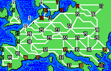
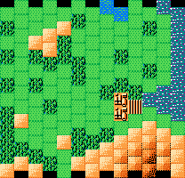

## 遊戲數值

| ID | 日文名 | 英文名 | 中文名 | 人口 | 農業 | 武器 | 港 |
| :--- | :--- | :--- | :--- | :--- | :--- | :--- | :--- |
| 0 | ダブリン | Dublin | 都柏林 | | | | |

## 地圖

<!-- data:map-world begin -->
<figure class="kw-map">

<figcaption>大地圖（FC 版）</figcaption>
</figure>
<!-- data:map-world end -->

<!-- data:map-battle begin -->
<figure class="kw-map">

<figcaption>戰場地圖（FC 版）</figcaption>
</figure>
<!-- data:map-battle end -->

## 簡介

都柏林（Dublin）在拿破崙時代是[英格蘭](/用語/英格蘭)統治下的愛爾蘭王國之首府。當時愛爾蘭與英國的關係極其緊張，1798 年爆發的愛爾蘭起義（受法國大革命激勵）雖然被鎮壓，但促使了 1801 年《聯合法令》的通過，使都柏林失去了愛爾蘭議會的地位，正式併入大不列顛及愛爾蘭聯合王國。

在軍事戰略上，都柏林是英國在愛爾蘭海的主要據點。雖然[拿破崙](/人物/拿破崙時代/拿破崙)曾計畫利用愛爾蘭的反英情緒，透過派遣部隊登陸愛爾蘭來開闢「第二戰場」，但由於皇家海軍的嚴密封鎖，法軍的支援始終難以成規模到達。都柏林在這一時期維持著英帝國第二大城市的繁榮，但社會底層的貧婚與政治上的壓抑，使其始終是反抗勢力的溫床。

### 攻略要點

<kbd>拿</kbd> 由於只能從海路進攻，只要能成功登陸基本就宣告勝利。建議從南方的山區砲擊城市周邊，但最好在征服大不列顛島後再行進攻。

