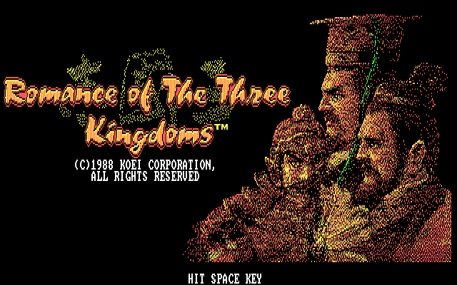

# 三國志

《三國志》是光榮於 1985 年推出的歷史模擬遊戲，三國志系列的第一作。玩家扮演漢末群雄之一，以州為單位經營內政、外交與軍事，目標是統一中國。

Steam 版本的《三國志》是以 PC98 版為基礎做移植。

## 人物 Persons

主條目：[三國志 人物資料一覽](/遊戲/三國志/人物資料)

## 顏 Faces

主條目：[三國志 人物顏](/遊戲/三國志/人物顏)

## 地點 Places

主條目：[三國志 都市資料一覽](/遊戲/三國志/都市資料一覽)

## References

- [三國志 - 中文 DOS 遊戲資料庫](https://cdosgame.simagame.me/games/cdg-0210/)
