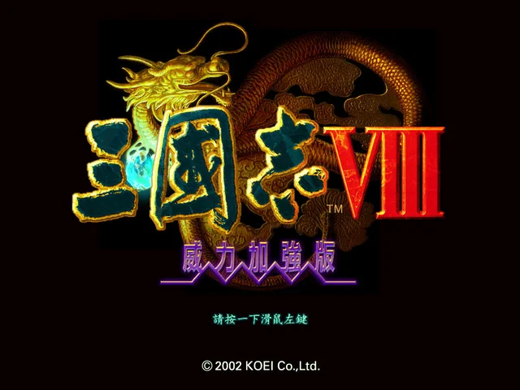

# 三國志VIII

《三國志VIII》是光榮於 2001 年推出的三國志系列第八作。延續前作的武將扮演，可從八種身分中擇一，並引入《太閤立志傳》的人物養成。

## 人物 Persons

主條目：[三國志VIII 人物資料一覽](/遊戲/三國志VIII/人物資料)

## 顏 Faces

主條目：[三國志VIII 人物顏](/遊戲/三國志VIII/人物顏)

## 地點 Places

主條目：[三國志VIII 都市資料一覽](/遊戲/三國志VIII/都市資料一覽)

## References

- [三國志8 - 中文 DOS 遊戲資料庫](https://cdosgame.simagame.me/games/cdg-0217/)
