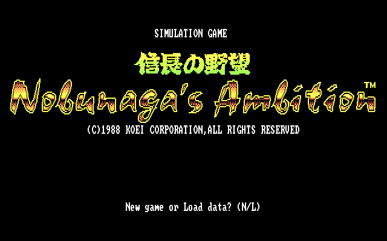

《信長之野望》是一款以日本戰國時代為題材的電腦策略模擬遊戲，於1983年3月由光榮發售，該遊戲在日本遊戲市場確立了「歷史模擬遊戲」的遊戲類型。本作是「信長之野望系列」的第一作，通稱為「初代信長之野望」。

遊戲的封面插畫，是以長興寺所藏的紙本著色織田信長像為藍本製作而成。

## References

- [信長之野望 - 中文 DOS 遊戲資料庫](https://cdosgame.simagame.me/games/cdg-1637/)
