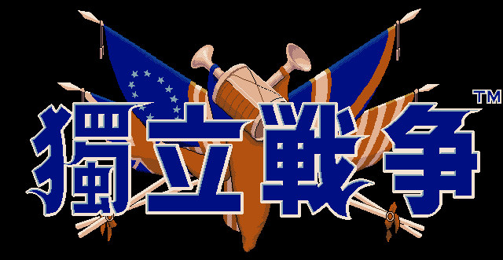

# 獨立戰爭

《獨立戰爭》（Liberty or Death）是光榮於 1993 年推出的歷史模擬遊戲，以美國獨立戰爭為題材，標題出自派屈克·亨利的名言「不自由，毋寧死」。玩家可選大陸軍或英軍，從三名史實總司令中擇一指揮。

## 人物 Persons

主條目：[獨立戰爭 人物資料一覽](/遊戲/獨立戰爭/人物資料)

## 顏 Faces

主條目：[獨立戰爭 人物顏](/遊戲/獨立戰爭/人物顏)

## References

- [獨立戰爭 - 中文 DOS 遊戲資料庫](https://cdosgame.simagame.me/games/cdg-3540/)
